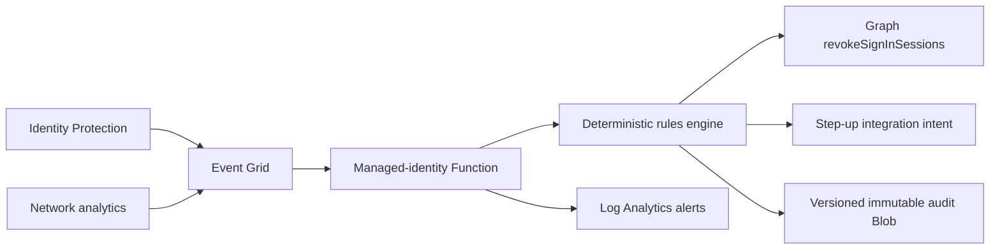

# CAE Adaptive Enforcer

An explainable, fail-safe intervention engine for high-confidence Entra identity
and network risk. It validates tenant-scoped events, correlates independent
signal domains, protects break-glass identities, rejects stale or malformed
evidence, emits deterministic actions, deduplicates event IDs, and maintains a
tamper-evident decision chain.

`revoke_sessions` is an executable Microsoft Graph action.
`require_step_up` is an intent for a preconfigured Conditional Access
authentication context or downstream policy integration; this sample does not
mutate Conditional Access policies per event.

## Example synopsis

Fresh multi-domain risk events are correlated into monitor, step-up, quarantine, or session-revocation decisions while break-glass users, duplicates, collisions, and stale evidence are handled safely.

## Real-world scenario

A security team needs to react to token theft faster than normal access-token expiry. The enforcer turns high-confidence risk signals into explainable interventions without claiming that every client supports instantaneous CAE enforcement.

## Architecture



## Reproduce the vertical slice

The rules engine uses Python 3.11+ and no third-party packages.

```bash
python3 src/enforcer.py replay \
  --policy config/policy.json \
  --events examples/risk-events.json \
  --database build/replay.db \
  --output build/replay-report.json
./scripts/validate.sh
```

The fixture includes malicious, benign, break-glass, stale, step-up, and
duplicate scenarios. The report contains pseudonymous subject references and
hash-chained evidence, not raw user identifiers.

## Azure application asset

[[`function_app.py`](function_app.py)](function_app.py) is an Azure Functions Event Grid adapter. It obtains tokens
with managed identity, calls Graph only for a `revoke_sessions` decision, and
writes one immutable audit Blob per event. Dependencies are pinned in
[[`requirements.txt`](requirements.txt)](requirements.txt).

The managed identity requires admin-consented Microsoft Graph application
permission `User.RevokeSessions.All` (`77f3a031-c388-4f99-b373-dc68676a979e`).
Grant it only after security review and verify it does not hold broader
directory write roles.

## Deploy

```bash
az deployment group what-if \
  --resource-group <disposable-rg> \
  --template-file infra/main.bicep \
  --parameters deployPlatform=true tenantId=<tenant-guid>
```

Deploy code and validate the Function before setting
`deployEventSubscription=true`. The template creates chargeable Premium
Functions, Storage, Event Grid, and monitoring resources. It disables storage
shared keys and uses identity-based host storage. Public endpoints remain
service-authenticated integration surfaces in this slice; production private
networking and egress controls are explicit follow-up gates.

## Honest CAE boundary

Session revocation is a critical event that CAE-capable resource providers can
enforce near real time, but propagation can take up to 15 minutes and unsupported
clients may retain access until token expiry. This project measures request and
Graph response latency; it cannot claim every downstream session is terminated
at that instant.

See [architecture](docs/architecture.md), [threat model](docs/threat-model.md),
[runbook](docs/runbook.md), [test matrix](docs/test-matrix.md), and
[cost model](docs/cost-model.md).

## Repository guide

- [Architecture](docs/architecture.md)
- [Threat model](docs/threat-model.md)
- [Operations runbook](docs/runbook.md)
- [Test matrix](docs/test-matrix.md)
- [Cost model](docs/cost-model.md)
- [Security policy](SECURITY.md)
- [Contributing guide](CONTRIBUTING.md)
- [Support policy](SUPPORT.md)
- [Changelog](CHANGELOG.md)
- [License](LICENSE)
